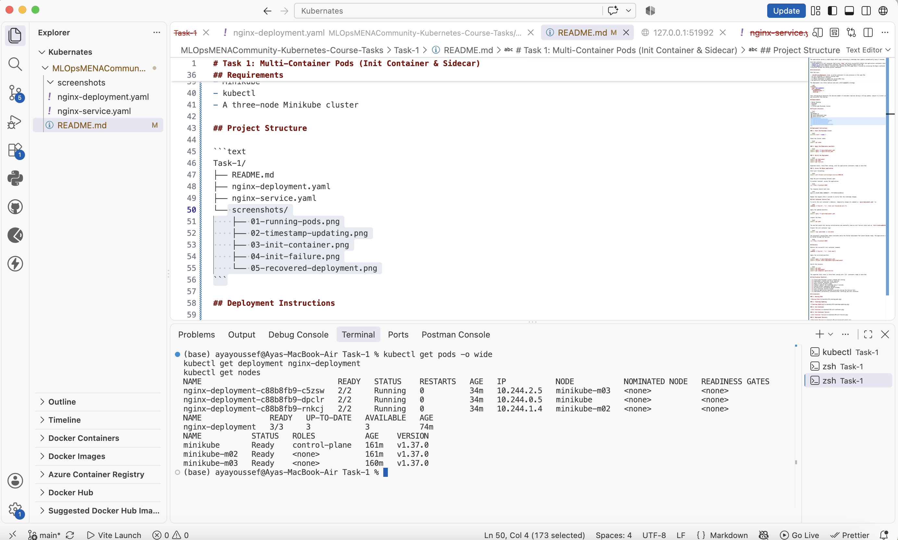
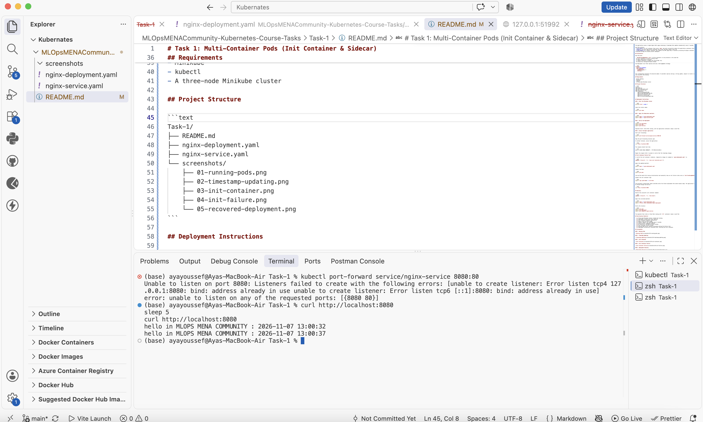
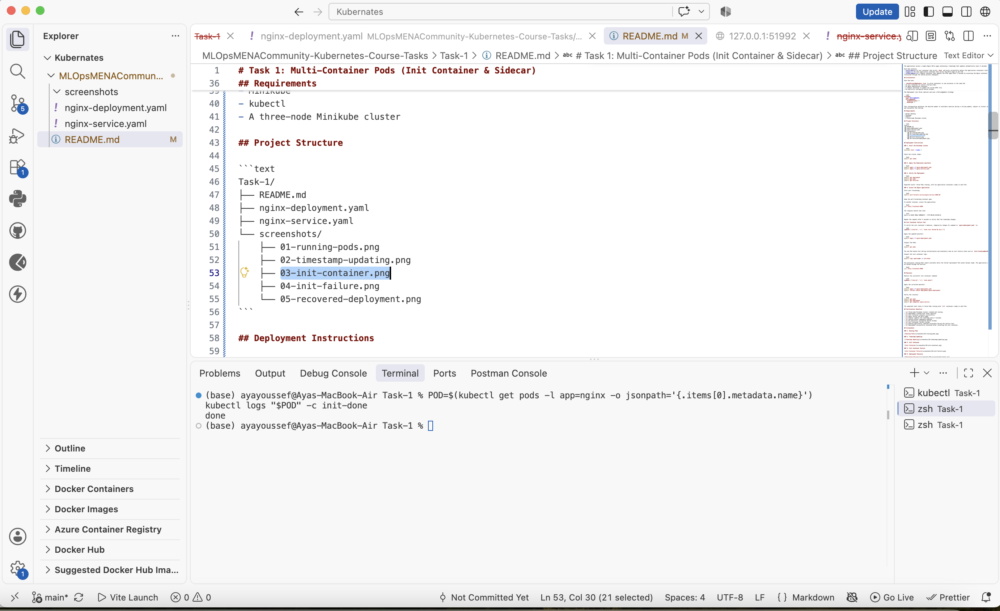
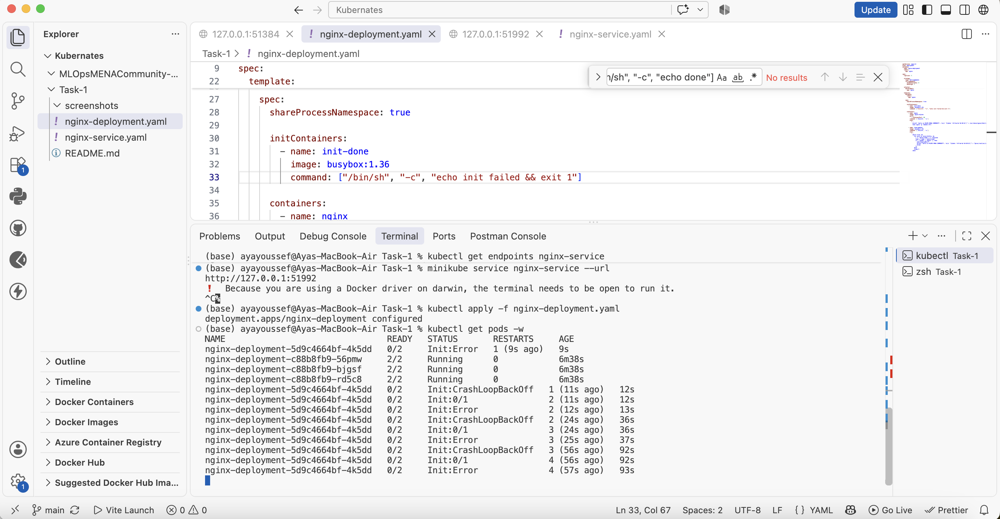
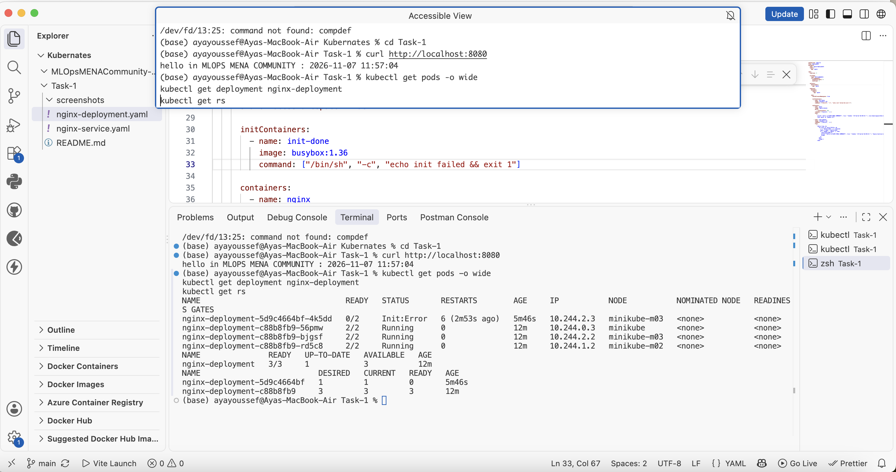

# Task 1: Multi-Container Pods (Init Container & Sidecar)

## Overview

This task demonstrates how to deploy a multi-container application on a three-node Kubernetes cluster using Minikube.

The application serves a simple Nginx Hello page containing a timestamp that updates automatically every 5 seconds.

Each Pod contains:
- **init-done:** An init container that prints `done` and exits successfully before the application containers start.
- **nginx:** The main application container that serves the Hello page on port 80.
- **time-updater:** A sidecar container that updates the HTML page every 5 seconds by accessing the Nginx container's filesystem through the shared process namespace.

## Architecture

Each Pod uses:

- `shareProcessNamespace: true` to allow containers to see processes in the same Pod.
- An init container to control startup order.
- An Nginx application container.
- A sidecar container to update the served HTML file.
- No explicitly configured shared volumes.

The Deployment runs three replicas and uses a RollingUpdate strategy:

```yaml
strategy:
  type: RollingUpdate
  rollingUpdate:
    maxUnavailable: 0
    maxSurge: 1
```

This configuration maintains the desired number of available replicas during a rolling update, subject to cluster capacity and successful Pod startup.

## Requirements

- Docker Desktop
- Minikube
- kubectl
- A three-node Minikube cluster

## Project Structure

```text
Task-1/
├── README.md
├── nginx-deployment.yaml
├── nginx-service.yaml
└── screenshots/
    ├── 01-running-pods.png
    ├── 02-timestamp-updating.png
    ├── 03-init-container.png
    ├── 04-init-failure.png
    └── 05-recovered-deployment.png
```

## Deployment Instructions

### 1. Start the Minikube cluster

```bash
minikube start --nodes 3
```

Check the cluster nodes:

```bash
kubectl get nodes
```

### 2. Apply the Kubernetes manifests

```bash
kubectl apply -f nginx-deployment.yaml
kubectl apply -f nginx-service.yaml
```

### 3. Verify the Deployment

```bash
kubectl get deployment
kubectl get pods
kubectl get services
```

Expected result: three Pods running, with two application containers ready in each Pod.

### 4. Access the Nginx application

Start port forwarding:

```bash
kubectl port-forward service/nginx-service 8080:80
```

Keep the port-forwarding terminal open.

In another terminal, access the application:

```bash
curl http://localhost:8080
```

The response should look like:

```text
hello in MLOPS MENA COMMUNITY : YYYY-MM-DD HH:MM:SS
```

Repeat the request after 5 seconds to verify that the timestamp changes.

## Init Container Failure Test

To verify the init container's behavior, temporarily change its command in `nginx-deployment.yaml` to:

```yaml
command: ["/bin/sh", "-c", "echo init failed && exit 1"]
```

Apply the updated manifest:

```bash
kubectl apply -f nginx-deployment.yaml
```

Inspect the Pods:

```bash
kubectl get pods
```

The new Pod should fail during initialization and eventually show an init failure state such as `Init:CrashLoopBackOff`.

Inspect the init container logs:

```bash
kubectl logs <pod-name> -c init-done
```

The previously running Pods remain available while the failed replacement Pod cannot become ready. The application can still be tested through the Service:

```bash
curl http://localhost:8080
```

## Recovery

Restore the successful init container command:

```yaml
command: ["/bin/sh", "-c", "echo done"]
```

Apply the corrected manifest:

```bash
kubectl apply -f nginx-deployment.yaml
kubectl rollout status deployment/nginx-deployment
```

Verify the recovery:

```bash
kubectl get pods
kubectl get deployment
kubectl get endpoints nginx-service
```

The expected final state is three Pods running with `2/2` containers ready in each Pod.

## Verification Checklist

- [x] Three-node Minikube cluster created and running.
- [x] Deployment created with three replicas.
- [x] Init container executes successfully.
- [x] Nginx serves the Hello page.
- [x] Sidecar updates the timestamp every 5 seconds.
- [x] Shared process namespace enabled.
- [x] No explicitly configured shared volumes.
- [x] Init container failure tested.
- [x] Running application remained accessible during the failure test.
- [x] Deployment successfully recovered after restoring the init container.

## Screenshots

### 1. Running Pods



### 2. Timestamp Updating



### 3. Init Container



### 4. Init Container Failure



### 5. Deployment Recovery



## Conclusion

This task demonstrates Kubernetes multi-container Pod design using init containers and sidecars, shared process namespaces, rolling updates, failure handling, and application recovery.

The final deployment successfully runs three replicas of the Nginx application, with the sidecar continuously updating the served timestamp.