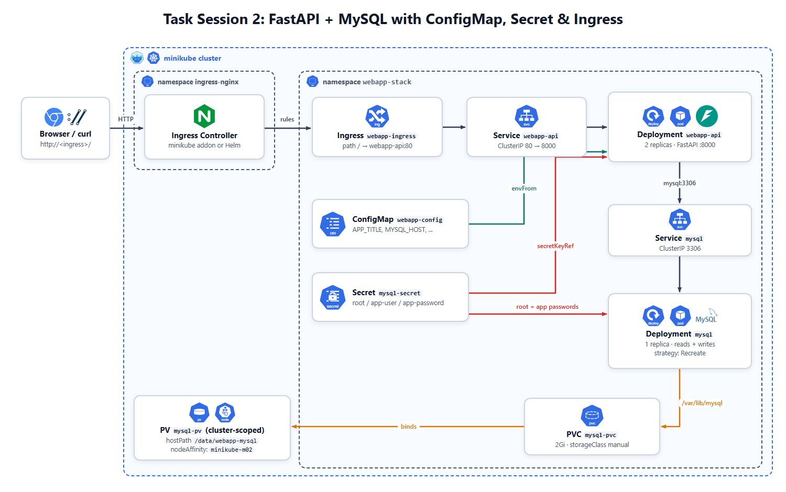
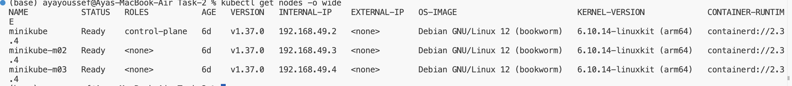
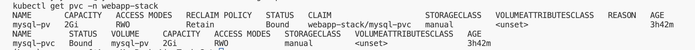
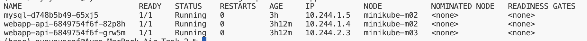
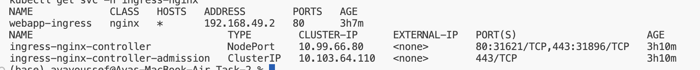
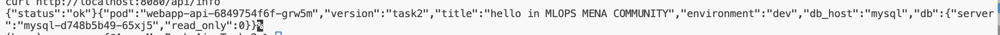
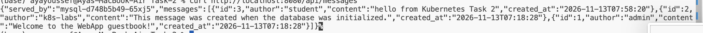
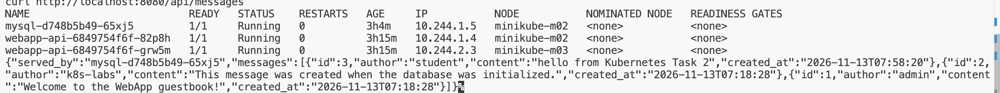

# Task 2: FastAPI + MySQL with ConfigMap, Secret & Ingress

## Overview

This task deploys a FastAPI guestbook application connected to a MySQL database on a three-node Kubernetes cluster using Minikube.

The application supports creating and retrieving guestbook messages. Kubernetes ConfigMaps and Secrets manage configuration and credentials, while PersistentVolumes and PersistentVolumeClaims provide persistent database storage. NGINX Ingress exposes the application.

## Architecture



The request flow is:

1. Browser sends a request to the NGINX Ingress Controller.
2. Ingress routes traffic to the `webapp-api` Service.
3. The Service distributes requests across two FastAPI Pods.
4. FastAPI connects to MySQL through the `mysql` Service.
5. MySQL stores data using the `mysql-pvc` PersistentVolumeClaim.

## Technologies

- Kubernetes 1.37.0
- Minikube 1.39.0
- Docker Desktop
- FastAPI
- MySQL 8.4
- NGINX Ingress Controller
- ConfigMaps and Secrets
- PersistentVolumes and PersistentVolumeClaims

## Repository Structure

```text
Task-2/
├── README.md
├── ingress.yaml
├── mysql.yaml
├── storage.yaml
├── webapp.yaml
├── mysql/
│   └── Dockerfile
├── webapp/
│   ├── Dockerfile
│   ├── .dockerignore
│   └── requirements.txt
└── images/
    └── architecture.png
```

## Kubernetes Resources

| Resource | Name | Configuration |
|---|---|---|
| Namespace | `webapp-stack` | Application namespace |
| ConfigMap | `webapp-config` | Application and database settings |
| Secret | `mysql-secret` | Database credentials |
| PersistentVolume | `mysql-pv` | 2Gi hostPath storage |
| PersistentVolumeClaim | `mysql-pvc` | 2Gi, ReadWriteOnce |
| MySQL Deployment | `mysql` | 1 replica |
| MySQL Service | `mysql` | ClusterIP, port 3306 |
| FastAPI Deployment | `webapp-api` | 2 replicas |
| FastAPI Service | `webapp-api` | ClusterIP, port 80 |
| Ingress | `webapp-ingress` | NGINX, HTTP path `/` |

The MySQL PersistentVolume uses node affinity to keep its hostPath storage on `minikube-m02`, ensuring the database Pod uses the node where its persistent data is stored.

## Configuration Management

### ConfigMap

The `webapp-config` ConfigMap contains:

- `APP_TITLE`
- `APP_ENV`
- `MYSQL_HOST`
- `MYSQL_PORT`
- `MYSQL_DATABASE`

### Secret

The `mysql-secret` Secret contains:

- `root-password`
- `app-user`
- `app-password`

Database credentials are injected into the application and MySQL containers through Kubernetes Secrets.

**Security note:** Actual credentials are not included in this repository.

## Deployment Steps

### 1. Start the Existing Minikube Cluster

```bash
minikube start
kubectl get nodes -o wide
```

The task uses the existing three-node cluster.

### 2. Build the Docker Images

```bash
chmod -x mysql/initdb/01-setup.sh

docker build -t webapp-api:task2 ./webapp
docker build -t webapp-mysql:task2 ./mysql
```

Load the images into Minikube:

```bash
minikube image load webapp-api:task2
minikube image load webapp-mysql:task2
```

### 3. Create Configuration Resources

Create the `webapp-stack` namespace, `mysql-secret` Secret, and `webapp-config` ConfigMap.

The Secret stores the MySQL root password, application database username, and application database password. The ConfigMap stores the application settings and database connection configuration.

### 4. Deploy Persistent Storage

```bash
kubectl apply -f storage.yaml

kubectl get pv
kubectl get pvc -n webapp-stack
```

Both the PV and PVC should reach the `Bound` status.

### 5. Deploy MySQL

```bash
kubectl apply -f mysql.yaml

kubectl get pods -n webapp-stack -o wide
kubectl get svc -n webapp-stack
```

MySQL runs as a single replica and mounts the persistent volume claim at `/var/lib/mysql`.

### 6. Deploy FastAPI

```bash
kubectl apply -f webapp.yaml

kubectl get deployments -n webapp-stack
kubectl get pods -n webapp-stack -o wide
```

The FastAPI deployment runs two replicas and obtains its configuration from the ConfigMap and database credentials from the Secret.

### 7. Enable and Configure Ingress

Enable the Minikube NGINX Ingress addon:

```bash
minikube addons enable ingress
```

Apply the Ingress resource:

```bash
kubectl apply -f ingress.yaml

kubectl get ingress -n webapp-stack
```

### 8. Access the Application

Forward the Ingress controller to localhost:

```bash
kubectl port-forward -n ingress-nginx \
  svc/ingress-nginx-controller 8080:80
```

Keep the port-forward command running and access the application at:

`http://localhost:8080`

## Verification and Testing

### Application Health

```bash
curl http://localhost:8080/health
```

Expected response:

```json
{"status":"ok"}
```

### Application Information

```bash
curl http://localhost:8080/api/info
```

Verified the application version, title, environment, and database connection information.

### Retrieve Guestbook Messages

```bash
curl http://localhost:8080/api/messages
```

The database initially contained two messages created during initialization.

### Create a New Message

```bash
curl -X POST http://localhost:8080/api/messages \
  -H "Content-Type: application/json" \
  -d '{"author":"student","content":"hello from Kubernetes Task 2"}'
```

The new message was successfully created and returned by the GET endpoint.

### Persistent Storage Test

To verify that MySQL data survives Pod replacement:

```bash
kubectl delete pod -n webapp-stack -l app=mysql
```

Kubernetes automatically created a replacement MySQL Pod.

After the replacement Pod became ready, the guestbook messages were retrieved again:

```bash
curl http://localhost:8080/api/messages
```

**Result:** All three messages, including the newly created message, remained available after MySQL Pod replacement. This verified data persistence through the configured PV and PVC.

## Screenshots

## Screenshots

### 1. Kubernetes Cluster


### 2. Persistent Storage


### 3. Running Pods


### 4. Ingress Configuration


### 5. API Health and Information


### 6. Guestbook Messages


### 7. Persistence After MySQL Pod Replacement


## Result

Successfully deployed a FastAPI and MySQL guestbook application on a three-node Minikube cluster.

The task demonstrates Kubernetes deployments, Services, service discovery, ConfigMaps, Secrets, persistent storage, Ingress routing, and database recovery without losing stored messages.